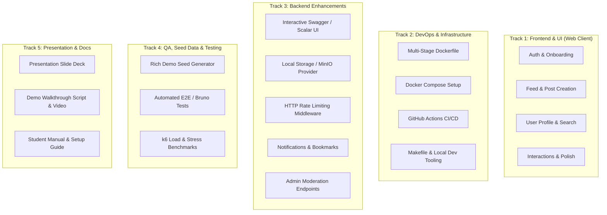

# Spill Social Media Platform — Remaining Tasks & Project Roadmap

> **Project:** Spill — Social Media Platform API (DEPI Graduation / Class Project)  
> **Status:** Backend Core API Complete (27/27 Functional Requirements Met, 8/8 Security Checks Passed)  
> **Target:** Transform the project into a comprehensive, showcase-ready, full-stack class project for academic evaluation and live demonstration.

---

## 1. Executive Summary & Gap Analysis

A rigorous audit of the project documentation ([`system-design.md`](docs/system-design.md), [`openapi.yaml`](docs/openapi.yaml), [`final-report.md`](docs/final-report.md), [`traceability.md`](docs/traceability.md), [`security-checklist.md`](docs/security-checklist.md)) against the current codebase reveals the following state:

### Current Strengths (Already Completed ✅)
- **Backend Core API (100%):** 27/27 requirements implemented across 20+ REST endpoints.
- **Database Architecture:** PostgreSQL 16 schema with generated columns, GIN full-text search indexes, composite keys, and triggers maintaining counter consistency (`follower_count`, `following_count`, `like_count`, `comment_count`, `share_count`).
- **Security:** Passwordless OTP authentication, SHA-256 hashed codes and refresh tokens, pinned HS256 JWT, RLS enabled on all 10 public tables, server-side MIME and payload size enforcement, and strict public view DTOs hiding private emails and birthdates.
- **Test Automation:** 100% green test suite across 7 packages utilizing `testcontainers-go` for PostgreSQL 16.

### Identified Gaps & Deficiencies for a Top-Tier Class Project ⚠️
1. **No User Interface (Frontend):** The system design illustrates a `"Web Client"`, but currently zero frontend code exists. Evaluators and professors cannot visually interact with the platform without specialized tools (`curl`/`Bruno`).
2. **Missing Containerization (DevOps):** There is no `Dockerfile` or `docker-compose.yml`. Anyone running the app must manually configure Go, PostgreSQL, Mailpit, and Supabase credentials.
3. **No Embedded API Documentation UI:** `openapi.yaml` exists, but there is no interactive Swagger UI or Scalar documentation served directly from the Go backend.
4. **Minimal Demo Seed Data:** `cmd/seed/main.go` only provisions 3 empty users (`admin`, `alice`, `bob`) with zero posts, comments, likes, or images, making live presentations look empty.
5. **No Local Object Storage Fallback:** Assets strictly depend on a live Supabase project. If testing offline or without Supabase keys, image upload fails.
6. **Open Items from Final Report:** HTTP-level rate limiting (`chi/httprate`) and production email delivery remain unaddressed.
7. **Missing Key Social Media Features:** Standard social features that elevate an academic project—such as Notifications, Saved Posts (Bookmarks), Hashtag filtering, and an Admin Moderation Panel—are not yet implemented.
8. **Academic Presentation Deliverables:** Slide deck, demo video, architectural decision records (ADRs), and grading rubric checklist are missing.

---

## 2. Team Track Overview

Assign tasks across the team according to these functional tracks:

---

## 3. Prioritized Task List

### Track 1: Frontend & Client Application (Crucial for Demo)

#### [FE-01] Frontend Project Scaffolding & Design System
- **Priority:** 🔴 Must-Have (Critical)
- **Assignee:** Frontend Lead
- **Estimated Effort:** 4–6 hours
- **Description:** Initialize a modern, responsive web application (recommended: **React + Vite** or **Next.js** with **Tailwind CSS** and **shadcn/ui** or **Lucide icons**).
- **Implementation Details:**
  - Create directory `/web` or `/frontend`.
  - Configure Axios / Fetch client with automatic Bearer token injection and refresh token rotation on `401 Unauthorized`.
  - Configure toast notification provider and light/dark theme toggle.
- **Definition of Done:** App builds cleanly, handles API base URL via `.env`, and displays responsive navigation layout (Sidebar, Feed Column, Search/Trending Widgets).

#### [FE-02] Passwordless Authentication Flow UI
- **Priority:** 🔴 Must-Have (Critical)
- **Assignee:** Frontend Engineer
- **Estimated Effort:** 5–7 hours
- **Description:** Implement the two-step passwordless OTP login and signup flow.
- **Implementation Details:**
  - **Step 1:** Email input form with validation (`POST /auth/request-code`). Displays 60-second cooldown timer.
  - **Step 2:** 6-digit OTP entry inputs (`POST /auth/verify`).
  - **Step 3 (New User):** Onboarding modal (`POST /auth/signup`) requesting `username`, `displayName`, and `birthdate` (with date picker and age ≥ 13 validation).
  - Persist tokens in `localStorage` or secure session storage. Provide Logout button (`POST /auth/logout`).
- **Definition of Done:** A new user can enter their email, input OTP, fill profile info, receive JWT tokens, and be redirected to the main feed seamlessly.

#### [FE-03] Interactive Feed & Keyset Pagination
- **Priority:** 🔴 Must-Have (Critical)
- **Assignee:** Frontend Engineer
- **Estimated Effort:** 6–8 hours
- **Description:** Render the main user feed (`GET /feed`) with infinite scrolling or a "Load More" button using the opaque `nextCursor`.
- **Implementation Details:**
  - Render post cards with: Author avatar, Display Name, `@username`, relative timestamp (e.g. `2h ago`), post text body, image gallery (1–4 images in grid layout).
  - Action bar: Like button with dynamic counter, Comment toggle button with count, Share button with count.
- **Definition of Done:** Feed loads posts from followed users, correctly handles empty state (prompts user to follow creators), and loads subsequent pages using `nextCursor`.

#### [FE-04] Post Creation Modal with Image Upload
- **Priority:** 🔴 Must-Have (Critical)
- **Assignee:** Frontend Engineer
- **Estimated Effort:** 6–8 hours
- **Description:** Post composer allowing users to write text (up to 2,000 characters) and upload up to 4 images via presigned URLs.
- **Implementation Details:**
  - File picker / drag-and-drop zone restricted to JPEG, PNG, WebP (< 5MB).
  - Presigned upload execution:
    1. Call `POST /assets` to get `presignedPutUrl` and `assetId`.
    2. Directly `PUT` binary to the presigned URL.
    3. Call `POST /assets/{id}/complete` to verify.
    4. Pass resulting `assetIds` into `POST /posts`.
  - Character countdown indicator (2000 max).
- **Definition of Done:** User can write a post, attach 1–4 photos, see upload progress indicators, submit, and immediately view the post at the top of their feed.

#### [FE-05] User Profile & Follow/Unfollow Management
- **Priority:** 🟡 High
- **Assignee:** Frontend Engineer
- **Estimated Effort:** 4–6 hours
- **Description:** Profile view (`GET /users/{username}`) and user posts timeline (`GET /users/{id}/posts`).
- **Implementation Details:**
  - Profile header: Avatar, Display Name, Username, Joined Date, Follower and Following counts.
  - Contextual action button: "Edit Profile" (if viewing own profile) or "Follow / Following" toggle button (calling `PUT/DELETE /users/{id}/follow`).
  - Followers and Following modal dialogs (`GET /users/{id}/followers`, `GET /users/{id}/following`).
  - Edit Profile modal (`PATCH /me`): update display name, avatar image upload.
- **Definition of Done:** Navigating to `@alice` displays her public stats, post history, and allows the logged-in user to follow/unfollow her with real-time UI count increments.

#### [FE-06] Comments Thread & Likes Interactivity
- **Priority:** 🟡 High
- **Assignee:** Frontend Engineer
- **Estimated Effort:** 4–5 hours
- **Description:** Collapsible comment section under each post.
- **Implementation Details:**
  - Fetch comments on demand (`GET /posts/{id}/comments`).
  - Add comment input bar (`POST /posts/{id}/comments`).
  - Delete comment button for comment author or post owner (`DELETE /comments/{id}`).
  - Optimistic UI updates when liking/unliking posts (`PUT/DELETE /posts/{id}/like`).
- **Definition of Done:** Users can open comments, post replies without page reloads, and see comment counts update instantly.

#### [FE-07] Global Search Page (Users, Posts, Comments)
- **Priority:** 🟡 High
- **Assignee:** Frontend Engineer
- **Estimated Effort:** 3–5 hours
- **Description:** Search interface implementing `GET /search?q=&type=users|posts|comments`.
- **Implementation Details:**
  - Search bar in top navbar with debounce (300ms).
  - Tabbed results interface: **Users** (shows avatar, name, handle, follow button), **Posts** (matching post cards), and **Comments**.
- **Definition of Done:** Searching `"alice"` or `"golang"` returns ranked full-text search results correctly segregated by category.

---

### Track 2: DevOps, Docker & Local Dev Environment

#### [OPS-01] Production Multi-Stage Dockerfile
- **Priority:** 🔴 Must-Have (Critical)
- **Assignee:** DevOps Engineer
- **Estimated Effort:** 2–3 hours
- **Description:** Create a clean, production-ready multi-stage Dockerfile for the Go backend.
- **Implementation Details:**
  - Create `/Dockerfile`:
    - **Stage 1 (Builder):** `golang:1.24-alpine` (or current Go version) to compile binary with `-ldflags="-s -w"`.
    - **Stage 2 (Runner):** `gcr.io/distroless/static-debian12` or `alpine:3.20` with non-root user.
  - Include healthcheck matching `/health` endpoint.
- **Definition of Done:** `docker build -t spill-backend:latest .` succeeds with an image size under 35MB and passes healthchecks.

#### [OPS-02] Comprehensive `docker-compose.yml`
- **Priority:** 🔴 Must-Have (Critical)
- **Assignee:** DevOps Engineer
- **Estimated Effort:** 3–4 hours
- **Description:** Provide a one-command local environment running all backend services.
- **Implementation Details:**
  - Create `docker-compose.yml` defining:
    1. `postgres`: PostgreSQL 16 with volume mount to automatically execute `migrations/000001_init.up.sql` on startup.
    2. `mailpit`: SMTP server on `:1025` and Web UI on `:8025` to view OTP emails.
    3. `backend`: The Go application listening on `:8080`, linked to postgres and mailpit.
    4. *(Optional)* `minio`: Local S3 storage on `:9000` / `:9001` for offline file uploads.
- **Definition of Done:** Running `docker compose up -d` launches the entire stack; visiting `localhost:8080/health` returns healthy and `localhost:8025` opens the Mailpit inbox.

#### [OPS-03] Developer Productivity `Makefile`
- **Priority:** 🟡 High
- **Assignee:** DevOps Engineer
- **Estimated Effort:** 1–2 hours
- **Description:** Add standard development targets for team convenience.
- **Implementation Details:**
  - Create `Makefile` with targets:
    - `make dev`: run server locally with hot-reload or `go run cmd/main.go`.
    - `make test`: execute `go test -race -v ./...`.
    - `make seed`: run `go run cmd/seed/main.go`.
    - `make verify`: run `go run cmd/verify/main.go`.
    - `make docker-up` / `make docker-down`.
    - `make lint`: execute `golangci-lint run`.
- **Definition of Done:** Teammates can execute `make dev` and `make test` without remembering complex CLI flags.

#### [OPS-04] GitHub Actions CI/CD Pipeline
- **Priority:** 🟡 High
- **Assignee:** DevOps Engineer
- **Estimated Effort:** 2–3 hours
- **Description:** Automated CI workflow running on every push and pull request.
- **Implementation Details:**
  - Create `.github/workflows/ci.yml`:
    - Step 1: Checkout repository.
    - Step 2: Setup Go environment with dependency cache.
    - Step 3: Run linter (`golangci-lint-action`).
    - Step 4: Run test suite (`go test -race -v -coverprofile=coverage.out ./...`).
    - Step 5: Test Docker image build.
- **Definition of Done:** Pull requests automatically show green checks for test pass and code formatting.

---

### Track 3: Backend Enhancements & Production Hardening

#### [BE-01] Embedded Interactive API Documentation (Swagger / Scalar UI)
- **Priority:** 🔴 Must-Have (Critical for grading)
- **Assignee:** Backend Engineer
- **Estimated Effort:** 2–3 hours
- **Description:** Expose an interactive documentation UI directly on the Go server at `/docs` or `/swagger`.
- **Implementation Details:**
  - Serve `docs/openapi.yaml` at `GET /docs/openapi.yaml`.
  - Embed [Scalar](https://github.com/scalar/scalar) or [Swagger UI](https://swagger.io/tools/swagger-ui/) via a lightweight HTML template handler at `GET /docs`.
  - Allow evaluators to test endpoints directly in the browser by setting a Bearer token.
- **Definition of Done:** Visiting `http://localhost:8080/docs` renders the complete OpenAPI contract with a "Try it out" test console.

#### [BE-02] Local Disk & MinIO Object Storage Provider
- **Priority:** 🟡 High
- **Assignee:** Backend Engineer
- **Estimated Effort:** 4–5 hours
- **Description:** Provide a local storage driver to enable offline development and demo runs without Supabase cloud credentials.
- **Implementation Details:**
  - Define unified `StorageClient` interface in `internal/storage`.
  - Implement `LocalStorageClient` that saves uploaded files to `./uploads/` and generates local download URLs served by an `http.FileServer` endpoint (`/uploads/*`).
  - Select storage provider via `STORAGE_PROVIDER=supabase|local|minio` in `.env`.
- **Definition of Done:** Setting `STORAGE_PROVIDER=local` allows asset upload, completion, and retrieval on `localhost` without an internet connection or Supabase API key.

#### [BE-03] HTTP-Level Rate Limiting Middleware
- **Priority:** 🟡 High
- **Assignee:** Backend Engineer
- **Estimated Effort:** 2–3 hours
- **Description:** Implement IP-based sliding window rate limiting to protect auth endpoints and prevent spam (addressing Open Item #1 from `docs/final-report.md`).
- **Implementation Details:**
  - Integrate a memory-efficient rate limiter (e.g. `tollbooth` or an in-memory token bucket).
  - Apply strict limits to sensitive routes:
    - `POST /auth/request-code`: 5 requests per IP per minute.
    - `POST /auth/verify`: 10 attempts per IP per 5 minutes.
    - Global API routes: 100 requests per IP per minute.
  - Return RFC 9457 `429 Too Many Requests` problem detail when exceeded.
- **Definition of Done:** Unit tests verify that exceeding 5 rapid calls to `/auth/request-code` returns HTTP 429 with `Retry-After` header.

#### [BE-04] In-App Notifications System
- **Priority:** 🟡 High (Major grade booster)
- **Assignee:** Backend Engineer
- **Estimated Effort:** 5–7 hours
- **Description:** Notify users when someone interacts with their content or profile.
- **Implementation Details:**
  - Add `notifications` table to database migrations:
    - `id`, `user_id` (recipient), `actor_id` (sender), `type` (`like`, `comment`, `share`, `follow`), `resource_id`, `read_at`, `created_at`.
  - Automatically create notification records inside like, comment, share, and follow service methods.
  - Expose endpoints:
    - `GET /notifications` (paginated list).
    - `GET /notifications/unread-count`.
    - `PATCH /notifications/{id}/read` and `POST /notifications/mark-all-read`.
- **Definition of Done:** When Alice likes Bob's post, Bob's `/notifications` endpoint contains a notification stating `"Alice liked your post"`.

#### [BE-05] Bookmarks / Saved Posts
- **Priority:** 🟢 Nice-to-Have (Polish)
- **Assignee:** Backend Engineer
- **Estimated Effort:** 3–4 hours
- **Description:** Allow users to save posts to a private bookmark collection.
- **Implementation Details:**
  - Create table `public.bookmarks (user_id uuid, post_id uuid, created_at timestamptz, PRIMARY KEY (user_id, post_id))`.
  - Expose `PUT /posts/{id}/bookmark`, `DELETE /posts/{id}/bookmark`, and `GET /me/bookmarks`.
- **Definition of Done:** Users can bookmark posts and retrieve their saved post list.

#### [BE-06] Admin Moderation & Platform Analytics Endpoints
- **Priority:** 🟢 Nice-to-Have (Class Distinction)
- **Assignee:** Backend Engineer
- **Estimated Effort:** 4–5 hours
- **Description:** Leverage the existing `role = 'admin'` column to provide management endpoints.
- **Implementation Details:**
  - Add admin routes protected by `middleware.RequireRole("admin")`:
    - `GET /admin/stats`: Total users, active users (last 24h), post volume, reported content.
    - `PATCH /admin/users/{id}/status`: Ban / suspend abusive users.
    - `GET /admin/audit-log`: Recent administrative actions.
- **Definition of Done:** An admin JWT can access `/admin/stats` and moderate content, while standard users receive `403 Forbidden`.

#### [BE-07] Structured Logging with `log/slog` & Prometheus Metrics
- **Priority:** 🟢 Nice-to-Have (Production Polish)
- **Assignee:** Backend Engineer
- **Estimated Effort:** 2–3 hours
- **Description:** Modernize backend telemetry for professional evaluation.
- **Implementation Details:**
  - Replace standard `log.Printf` in middleware with standard library `log/slog` (JSON format in production, text in dev).
  - Mount `/metrics` endpoint using `prometheus/client_golang` exporting HTTP duration histograms and active database connection pool stats.
- **Definition of Done:** Requests output structured JSON logs with correlation IDs (`req_id`), and `/metrics` outputs standard Prometheus metrics.

---

### Track 4: QA, Demo Seeding & Performance Benchmarking

#### [QA-01] Rich Demo Seed Generator
- **Priority:** 🔴 Must-Have (Critical for Demo Day)
- **Assignee:** QA / Database Specialist
- **Estimated Effort:** 3–4 hours
- **Description:** Upgrade `cmd/seed/main.go` and `scripts/seed.sql` to populate a bustling, realistic social network.
- **Implementation Details:**
  - Seed 15–20 realistic persona accounts (e.g. developers, designers, professors, students) with avatars and bios.
  - Create 40–60 realistic posts with tech and social topics (including hashtag strings like `#golang`, `#postgres`, `#depi`).
  - Establish a rich follow graph so `/feed` is populated with diverse content for any persona.
  - Seed 50+ likes, comments, and shares across posts to demonstrate trigger counter updates.
- **Definition of Done:** Running `go run cmd/seed/main.go` leaves the database in an active state where logging in as any user presents an engaging home timeline.

#### [QA-02] Postman / Bruno E2E Test Suite Automation
- **Priority:** 🟡 High
- **Assignee:** QA Engineer
- **Estimated Effort:** 3–4 hours
- **Description:** Expand the Bruno collection in `docs/api/spill-api/` with automated test assertions and export a Postman collection.
- **Implementation Details:**
  - Add test script assertions (`expect(res.status).to.equal(200)`) across all Bruno `.bru` files.
  - Export compatible Postman Collection v2.1 with pre-configured environment variables for team members who prefer Postman.
  - Add a CLI test runner script (`npx @usebruno/cli run docs/api/spill-api --env Local`).
- **Definition of Done:** Running the Bruno CLI command runs through the entire auth, posting, liking, and search lifecycle with 100% assertions passing.

#### [QA-03] k6 Load & Concurrency Benchmark Script
- **Priority:** 🟢 Nice-to-Have (Great for Project Report)
- **Assignee:** QA / Performance Lead
- **Estimated Effort:** 2–3 hours
- **Description:** Create reproducible load test scripts to demonstrate PostgreSQL indexing performance under concurrency.
- **Implementation Details:**
  - Write a `scripts/loadtest.js` using [k6](https://k6.io/).
  - Simulate 50 concurrent virtual users hitting `GET /feed`, `GET /search`, and `POST /posts/{id}/like`.
  - Capture p95 and p99 latency metrics to substantiate the `< 1ms` query claim from `docs/perf/README.md`.
- **Definition of Done:** Running `k6 run scripts/loadtest.js` outputs a performance summary report showing p95 latency < 50ms at 100 requests/sec.

---

### Track 5: Documentation, Academic Deliverables & Presentation

#### [DOC-01] Project Presentation Slide Deck
- **Priority:** 🔴 Must-Have (Academic Evaluation)
- **Assignee:** Team Lead / Technical Writer
- **Estimated Effort:** 4–6 hours
- **Description:** Prepare a professional slide presentation (15–20 slides) for project defense.
- **Implementation Details:**
  - Content Outline:
    1. Project Overview & Problem Statement.
    2. Architecture Overview (MVC, PostgreSQL as single source of truth, Stateless Go API).
    3. Key Technical Decisions (Why Passwordless OTP? Why Trigger-maintained counters? Keyset pagination).
    4. Database Schema & GIN Inverted Indexing.
    5. Security Audit Highlights (Zero raw passwords, pinned JWT, RLS).
    6. Performance Benchmark Results (`EXPLAIN ANALYZE`).
    7. Live Demo Walkthrough.
    8. Team Member Contributions & Lessons Learned.
  - Incorporate the exported Mermaid diagrams from [`assets/diagrams/`](assets/diagrams/).
- **Definition of Done:** A polished presentation deck (PDF / PPTX) ready for the project defense.

#### [DOC-02] Live Demo Script & Walkthrough Video
- **Priority:** 🔴 Must-Have (Academic Evaluation)
- **Assignee:** Team Lead
- **Estimated Effort:** 3–4 hours
- **Description:** Script out a chronological 5-minute live demonstration scenario to avoid glitches during presentation.
- **Implementation Details:**
  - Step 1: Open Mailpit and Web UI side-by-side.
  - Step 2: Register a new user (`POST /auth/request-code` -> check Mailpit -> enter OTP -> complete profile).
  - Step 3: Browse search for users and topics, follow 2 accounts.
  - Step 4: Create a post with an image attachment.
  - Step 5: Like and comment on existing posts (highlight instant trigger counter updates).
  - Step 6: Show Swagger UI / Bruno collection and pass of automated tests.
  - Record a backup 3-minute video screencast in case live network issues occur.
- **Definition of Done:** Written Markdown demo script stored at `docs/demo-script.md` and MP4 demo video recorded.

#### [DOC-03] Student Setup & Grading Guide (README Expansion)
- **Priority:** 🟡 High
- **Assignee:** Technical Writer
- **Estimated Effort:** 2 hours
- **Description:** Ensure any professor, teaching assistant, or classmate can run the project on their own computer in under 3 minutes.
- **Implementation Details:**
  - Update `README.md` with a "1-Minute Quick Start" using `docker compose up`.
  - Add troubleshooting FAQ (common Docker port conflicts, migration reset command).
- **Definition of Done:** A teammate on a clean machine can clone the repo and get both backend and frontend running within 5 minutes following the README.

---

## 4. Suggested Execution Sprints

| Sprint / Phase | Focus Area | Deliverables | Target Timeline |
|---|---|---|---|
| **Sprint 1: Fast Foundations** | DevOps, Tooling & Seeding | `Dockerfile`, `docker-compose.yml`, Swagger UI (`/docs`), Rich Demo Seed Script | Days 1–3 |
| **Sprint 2: Frontend Core MVP** | Web UI & Core Flows | Scaffolding, Passwordless Auth UI, Home Feed, Post Composer with Image Upload | Days 4–8 |
| **Sprint 3: Interactivity & Hardening** | Full-Stack Polish | Likes, Comments, Profiles, Search UI, Rate Limiting, Notifications, CI/CD | Days 9–12 |
| **Sprint 4: Defense & Polish** | Presentation & QA | Load testing, Slide Deck, Demo Video, Rehearsal, Final Code Cleanup | Days 13–15 |

---

## 5. Team Assignment Matrix

| Team Member | Role | Primary Assigned Tasks | Secondary Focus |
|---|---|---|---|
| **Member 1** | Frontend Lead | `FE-01`, `FE-02`, `FE-03`, `FE-04` | UI/UX & Responsive Layout |
| **Member 2** | Full-Stack / Frontend Dev | `FE-05`, `FE-06`, `FE-07`, `BE-04` | Notifications & Social Interactivity |
| **Member 3** | Backend & Database Lead | `BE-01`, `BE-02`, `BE-03`, `QA-01` | Local Storage, Swagger UI & Seed Data |
| **Member 4** | DevOps & Performance Lead | `OPS-01`, `OPS-02`, `OPS-03`, `OPS-04`, `QA-03` | Docker, CI/CD & k6 Load Tests |
| **Member 5** | QA, Docs & Presentation Lead | `QA-02`, `DOC-01`, `DOC-02`, `DOC-03` | Presentation Deck, Bruno/Postman & Demo Script |

*(Adjust assignments based on exact team size: 3-person, 4-person, or 5-person teams).*

---

## 6. Definition of a "Good Class Project" (Grading Checklist)

Use this checklist during final review before submission:

- [ ] **Working Visual Frontend:** An interactive web or mobile client allows grading without terminal commands.
- [ ] **One-Command Setup:** `docker compose up` starts Postgres, Mailpit, backend, and frontend.
- [ ] **Rich Live Demo Data:** The platform feels lively with populated users, feeds, comments, and photos.
- [ ] **100% Automated Tests Pass:** `go test ./...` passes with zero race conditions (`-race`).
- [ ] **Interactive API Docs:** Swagger/Scalar UI accessible at `http://localhost:8080/docs`.
- [ ] **Security Defense Prepared:** Able to explain passwordless OTP, JWT algorithm pinning, and PostgreSQL RLS policies to evaluators.
- [ ] **Database Integrity Explained:** Able to demonstrate that likes/follows counters cannot desynchronize thanks to PostgreSQL triggers.
- [ ] **Performance Evidence:** Able to present `EXPLAIN ANALYZE` proof showing indexed queries execute in < 1ms.
- [ ] **Professional Presentation:** Polished slide deck and a rehearsed 5-minute walkthrough script.
